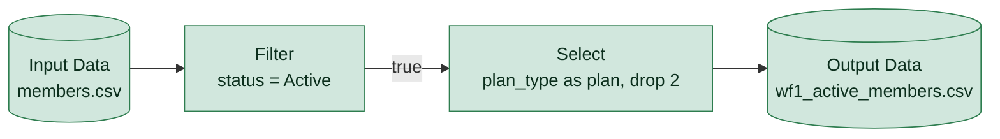

# wf1_active_members.yxmd

**Redshift migration difficulty: 2/10**, direct translation. 4 tools, 1 migration gotchas.

## In short

This workflow reads a members CSV file, keeps only rows where status is Active, renames and drops a couple of columns, then writes the result to an output CSV. It scores 2 out of 10, meaning it is a direct translation to SQL with no design decisions needed. All four tools are simple, low-difficulty operations that map one-to-one onto standard SQL clauses.

*Written by AI (claude-sonnet-5) from facts extracted by code; every cited tool was checked.*

## How data flows

## Main risks

**CSV source has no defined data types** (low)  
The input file is a CSV, which carries no column data types. When loading with COPY into Redshift, column types must be explicitly defined to avoid type mismatches or load errors.

## Next steps

1. Confirm the target column data types for the members table before writing the COPY/CREATE TABLE statement.
2. Translate the Filter [2] condition directly into a WHERE clause.
3. Translate the Select [3] renaming and column drop into the SELECT column list.
4. Decide whether Output Data [4] should become a CREATE TABLE AS, INSERT INTO, or UNLOAD to S3 based on downstream use.
5. Validate row counts and column values against the original CSV output after migration.

## Every gotcha found

| Severity | Issue | Tools | What to do in Redshift |
|---|---|---|---|
| low | Reads a CSV file, which carries no data types. | 1 | Load with COPY into a table whose column types are defined explicitly. |
