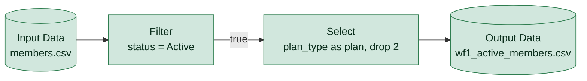

# wf1_active_members.yxmd

**Redshift migration difficulty: 2/10**, direct translation. 4 tools, 1 migration gotchas.

## In short

This workflow reads a members CSV file, keeps only active members, renames and drops a couple of columns, then writes the result to an output CSV. It scored 2 out of 10, meaning it is a direct translation to SQL with no complex logic. All four tools are simple, low-difficulty steps with standard SQL equivalents.

*Written by AI (claude-sonnet-5) from facts extracted by code; every cited tool was checked.*

## How data flows

## Main risks

**CSV source has no defined data types** (low)  
A CSV file carries no column type information, so the Redshift table used to load it must have explicit column types defined; otherwise values may be loaded or interpreted incorrectly.

## Next steps

1. Define explicit column data types for the target Redshift table before loading members.csv via COPY.
2. Confirm which two columns are dropped in the Select [3] step to replicate the exact column list in SQL.
3. Decide whether the final output should be a Redshift table (CREATE TABLE AS or INSERT INTO) or an UNLOAD to S3.
4. Validate the WHERE clause logic for status = Active against the source data to ensure consistent filtering.

## Every gotcha found

| Severity | Issue | Tools | What to do in Redshift |
|---|---|---|---|
| low | Reads a CSV file, which carries no data types. | 1 | Load with COPY into a table whose column types are defined explicitly. |
