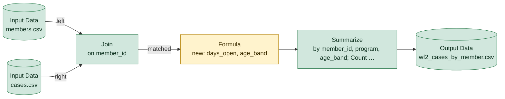

# wf2_cases_by_member.yxmd

**Redshift migration difficulty: 4/10**, a few rewrites. 6 tools, 10 migration gotchas.

## In short

This workflow joins a members file and a cases file on member ID, calculates how long each case has been open and an age band for each member, then summarizes case counts and average days open by member, program, and age band. It scores 4 out of 10, meaning it needs a few targeted rewrites rather than a full redesign. The main driver is the Formula tool [4], which contains several date and number-handling patterns that behave differently in Redshift.

*Written by AI (claude-sonnet-5) from facts extracted by code; every cited tool was checked.*

## How data flows

## Main risks

**Average of an integer field loses precision** (high)  
days_open is a whole number, and Redshift's AVG on integers returns an integer, silently dropping decimal places. The field must be cast to DECIMAL or FLOAT before averaging.

**Date logic will behave differently without changes** (medium)  
The formula uses DateTimeDiff with arguments in the opposite order to Redshift's DATEDIFF, uses today's date (DateTimeToday) so results change daily, and uses IsEmpty, which treats NULL and empty text the same way SQL does not. Each of these needs a specific rewrite and could produce wrong or non-reproducible numbers if missed.

**Hardcoded year and risky text-to-number conversion** (medium)  
The age_band calculation uses a fixed year (2026) typed into the formula, so it will go stale over time, and converts birth_year text to a number with ToNumber; in Redshift an invalid value here would fail the whole query instead of behaving leniently.

**IIF function has no direct Redshift equivalent** (low)  
Both IIF expressions in the Formula tool [4] need to be rewritten as CASE WHEN statements; this is mechanical but must be done carefully to preserve logic.

**CSV inputs have no defined data types** (low)  
CSV files carry no type information, so column types (e.g., for birth_year, dates) must be explicitly defined when loading into Redshift via COPY.

## Next steps

1. Cast days_open to DECIMAL or FLOAT before applying AVG in the Summarize step [5].
2. Rewrite the DateTimeDiff logic in Formula [4] as DATEDIFF(unit, start, end), checking the sign of the result.
3. Replace DateTimeToday() in Formula [4] with CURRENT_DATE or GETDATE(), and decide whether to pin a fixed date for testing against old outputs.
4. Replace the hardcoded year (2026) in Formula [4] with a dynamic value, such as EXTRACT(YEAR FROM CURRENT_DATE), or a parameter.
5. Rewrite both IIF expressions in Formula [4] as CASE WHEN statements.
6. Define explicit column types when loading members.csv and cases.csv [1, 2] into Redshift, and test the IsEmpty/close_date logic for NULL vs. empty string handling.

## Every gotcha found

| Severity | Issue | Tools | What to do in Redshift |
|---|---|---|---|
| high | Averages a whole-number field. Redshift's AVG on integers returns an integer, dropping the decimals. | 5 | CAST the field to DECIMAL (or FLOAT) before AVG. |
| medium | DateTimeDiff(end, start, unit) puts the dates in the opposite order to Redshift. | 4 | DATEDIFF(unit, start, end). Check the sign of the result. |
| medium | Uses today's date, so results change every day. | 4 | CURRENT_DATE or GETDATE(). Pin a fixed date when comparing old and new outputs. |
| medium | A year is typed directly into the formula, so results go stale as time passes. | 4 | Derive it from the data or the current date (e.g. EXTRACT(YEAR FROM CURRENT_DATE)), or make it a parameter. |
| medium | IsEmpty is true for both NULL and empty text; SQL treats these separately. | 4 | (x IS NULL OR x = ''), or COALESCE(NULLIF(x, ''), ...). |
| medium | Converts text to numbers. A value that isn't a valid number can behave differently. | 4 | CAST(x AS DECIMAL(...)). In Redshift, invalid text makes the whole query fail. |
| low | Reads a CSV file, which carries no data types. | 1, 2 | Load with COPY into a table whose column types are defined explicitly. |
| low | IIF has no Redshift equivalent. | 4 | Rewrite as CASE WHEN ... THEN ... ELSE ... END. |
