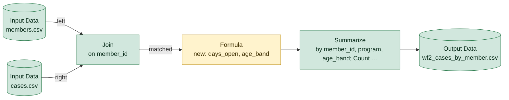

# wf2_cases_by_member.yxmd

**Redshift migration difficulty: 4/10**, a few rewrites. 6 tools, 10 migration gotchas.

## In short

This workflow joins a members file and a cases file on member_id, calculates how long each case has been open and an age band for the member, then summarizes case counts and average open-days by member, program, and age band. It scores 4/10, meaning most of it translates directly but a few parts need rewriting. The main driver is the Formula tool [4], which contains several calculation patterns that behave differently in Redshift.

*Written by AI (claude-sonnet-5) from facts extracted by code; every cited tool was checked.*

## How data flows

## Main risks

**Average on whole-number field loses decimals** (high)  
The Summarize tool [5] averages days_open, which is a whole-number (integer) field. Redshift's AVG on integers returns an integer, dropping any decimal places, so the result will look less precise than the original.

**Date calculation differences** (medium)  
The Formula tool [4] uses DateTimeDiff with arguments in the opposite order to Redshift's DATEDIFF, uses today's date (so output changes daily), and uses IsEmpty, which treats NULL and empty text the same way while SQL does not. Each of these needs careful rewriting to match the original logic exactly.

**Hardcoded year and text-to-number conversion** (medium)  
The age band formula in [4] hardcodes the year 2026, so results will go stale, and converts birth_year from text to a number; in Redshift an invalid value here would fail the whole query instead of just that record.

**Formula syntax and untyped source files** (low)  
IIF in the Formula tool [4] has no direct Redshift equivalent and must become CASE WHEN; the CSV inputs [1][2] have no column types, so types must be explicitly defined when loading into Redshift.

## Next steps

1. Rewrite the Formula tool [4] logic as CASE WHEN statements, matching DATEDIFF argument order (unit, start, end) and checking the sign of results.
2. Cast days_open to DECIMAL or FLOAT before applying AVG in the Summarize step [5].
3. Replace the hardcoded year 2026 in [4] with a dynamic value (e.g. EXTRACT(YEAR FROM CURRENT_DATE)) or a parameter.
4. Confirm whether close_date can be NULL, empty text, or both, and adjust the empty-check logic in [4] accordingly.
5. Define explicit column data types when loading members.csv and cases.csv [1][2] via COPY into Redshift.
6. Test birth_year conversion in [4] for any non-numeric values before casting, since invalid data will fail the query in Redshift.

## Every gotcha found

| Severity | Issue | Tools | What to do in Redshift |
|---|---|---|---|
| high | Averages a whole-number field. Redshift's AVG on integers returns an integer, dropping the decimals. | 5 | CAST the field to DECIMAL (or FLOAT) before AVG. |
| medium | DateTimeDiff(end, start, unit) puts the dates in the opposite order to Redshift. | 4 | DATEDIFF(unit, start, end). Check the sign of the result. |
| medium | Uses today's date, so results change every day. | 4 | CURRENT_DATE or GETDATE(). Pin a fixed date when comparing old and new outputs. |
| medium | A year is typed directly into the formula, so results go stale as time passes. | 4 | Derive it from the data or the current date (e.g. EXTRACT(YEAR FROM CURRENT_DATE)), or make it a parameter. |
| medium | IsEmpty is true for both NULL and empty text; SQL treats these separately. | 4 | (x IS NULL OR x = ''), or COALESCE(NULLIF(x, ''), ...). |
| medium | Converts text to numbers. A value that isn't a valid number can behave differently. | 4 | CAST(x AS DECIMAL(...)). In Redshift, invalid text makes the whole query fail. |
| low | Reads a CSV file, which carries no data types. | 1, 2 | Load with COPY into a table whose column types are defined explicitly. |
| low | IIF has no Redshift equivalent. | 4 | Rewrite as CASE WHEN ... THEN ... ELSE ... END. |
