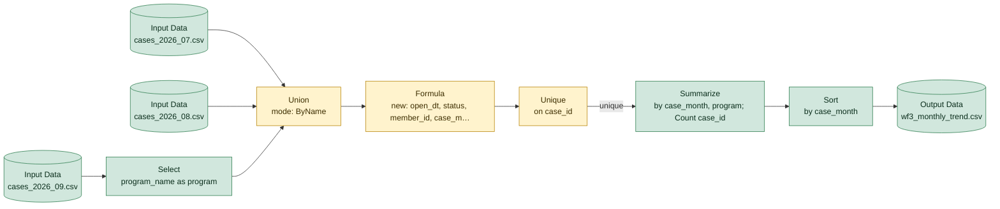

# wf3_monthly_trend.yxmd

**Redshift migration difficulty: 6/10**, design decisions needed. 10 tools, 15 migration gotchas.

## In short

This workflow reads three monthly case-extract CSV files, stacks them into one dataset, builds several calculated fields (including parsed dates and cleaned text), removes duplicate cases, then summarizes case counts by month and program for a trend report. It scores 6/10, meaning it needs real design decisions rather than a direct line-by-line translation. The main reasons are the Union [5], Formula [6], and Unique [7] tools, which all involve logic that Alteryx and SQL handle differently.

*Written by AI (claude-sonnet-5) from facts extracted by code; every cited tool was checked.*

## How data flows

## Main risks

**Date parsing logic depends on mixed formats in source data** (high)  
Formula [6] picks a date format based on separators and string length (e.g. '/' vs length 11), which implies the source open_date column itself has inconsistent formats. Alteryx's date parsing is more forgiving than Redshift's TO_DATE, so each format needs to be tested explicitly or rows may fail or parse incorrectly.

**Deduplication result depends on row order** (high)  
Unique [7] keeps the first row per case_id, but 'first' depends on the order rows arrive in Alteryx, which SQL does not guarantee. Without an explicit ORDER BY in a ROW_NUMBER() rewrite, Redshift could keep a different row than Alteryx did, changing results.

**Union relies on column names, not position** (medium)  
Union [5] is set to match columns by name (ByName), and a column is renamed (program_name to program) in Select [4] right before the union, implying the three input files don't use identical column names. UNION ALL in Redshift matches by position, so columns must be renamed and ordered identically in every SELECT or data will be misaligned.

**Empty string vs NULL handling may change** (medium)  
Formula [6] treats empty text and NULL the same way for member_id (IsEmpty), but standard SQL distinguishes NULL from an empty string. This needs an explicit check for both cases to avoid missing 'UNKNOWN' labels after migration.

**Minor function rewrites needed** (low)  
Formula [6] uses IIF, TitleCase, and date formatting functions that have no direct Redshift equivalent (CASE WHEN, INITCAP, TO_CHAR). These are mechanical rewrites but INITCAP can produce different capitalization results than TitleCase, so output should be spot-checked.

**CSV inputs have no enforced data types** (low)  
The three source files are plain CSVs with no built-in column types, so target table types must be defined explicitly when loading with COPY.

## Next steps

1. Document every date format present in the open_date column and write explicit TO_DATE logic for each.
2. Define an explicit ORDER BY to replicate the 'keep first row' behavior of Unique [7] using ROW_NUMBER().
3. Align column names and order across all three input sources before writing the UNION ALL that replaces Union [5].
4. Decide whether member_id should treat empty strings and NULLs the same, and encode that explicitly.
5. Spot-check INITCAP output against the original TitleCase results for the status field.
6. Define explicit column data types for the Redshift tables that will receive the COPY-loaded CSV data.

## Every gotcha found

| Severity | Issue | Tools | What to do in Redshift |
|---|---|---|---|
| high | Several date formats are parsed in one expression, so the source data mixes formats. | 6 | Handle each format explicitly. Alteryx can tolerate small format mismatches (such as separators) that a literal SQL translation may not; test every format. |
| high | Unique keeps the FIRST row per key; which row is first depends on the order data arrives. | 7 | ROW_NUMBER() OVER (PARTITION BY key ORDER BY ...) = 1 with an explicit ORDER BY. Plain DISTINCT only removes fully identical rows. |
| medium | Text search inside a string; case sensitivity may differ. | 6 | POSITION(...) > 0 or LIKE / ILIKE. Confirm whether matching should ignore case. |
| medium | Converts text to dates using Alteryx format codes (%Y, %m, %d, %b). | 6 | TO_DATE or TO_TIMESTAMP with Redshift format codes (YYYY, MM, DD, MON). |
| medium | IsEmpty is true for both NULL and empty text; SQL treats these separately. | 6 | (x IS NULL OR x = ''), or COALESCE(NULLIF(x, ''), ...). |
| medium | A column is renamed right before a Union, so the sources use different column names. | 4 | Apply the same alias in that SELECT before the UNION ALL. |
| medium | Union matches columns by name. | 5 | UNION ALL matches columns by position. List columns in the same order in every SELECT. |
| low | Reads a CSV file, which carries no data types. | 1, 2, 3 | Load with COPY into a table whose column types are defined explicitly. |
| low | Formats dates as text using Alteryx format codes. | 6 | TO_CHAR with Redshift format codes (e.g. 'YYYY-MM'). |
| low | IIF has no Redshift equivalent. | 6 | Rewrite as CASE WHEN ... THEN ... ELSE ... END. |
| low | String length, here possibly used to detect a format. | 6 | LEN or LENGTH. |
| low | Capitalizes words to normalize inconsistent text. | 6 | INITCAP. Results can differ for some words; spot-check the output. |
