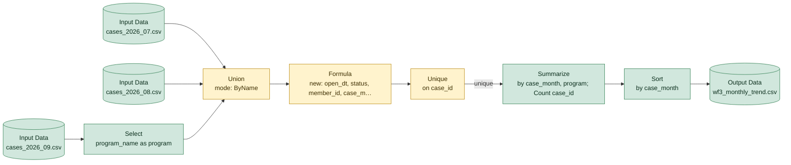

# wf3_monthly_trend.yxmd

**Redshift migration difficulty: 6/10**, design decisions needed. 10 tools, 15 migration gotchas.

## In short

This workflow combines three months of case data, cleans and deduplicates it, then summarizes case counts by month and program for a trend report. It scores 6/10, meaning the migration needs real design decisions rather than a direct rewrite. The main drivers are a Union [5] that matches columns by name, a Formula [6] with multiple date formats and mixed logic, and a Unique [7] step whose result depends on row order.

*Written by AI (claude-sonnet-5) from facts extracted by code; every cited tool was checked.*

## How data flows

## Main risks

**Unique keeps 'first' row, but SQL has no inherent row order** (high)  
Unique [7] keeps the first row per case ID based on the order Alteryx processes rows, which SQL does not guarantee. Without an explicit ORDER BY in a ROW_NUMBER() rewrite, Redshift could keep a different row, changing which case details survive.

**Mixed date formats in one field** (high)  
The open_date field contains at least three different date formats (e.g. slashes, dashes with month names, year-first), handled in Alteryx with nested conditions. Redshift's date functions are stricter about format, so each format must be tested separately to avoid silent parsing errors or nulls.

**Union relies on matching column names, not position** (medium)  
Union [5] combines sources by matching column names, and one source renames a column beforehand [4]. Redshift's UNION ALL matches by column position, so columns must be listed in the same order in every SELECT or data will land in the wrong column.

**Blank vs. NULL handling in member ID** (medium)  
The Formula [6] treats empty text and NULL member IDs the same way, but SQL distinguishes them. The rewrite needs to explicitly check for both cases or some 'UNKNOWN' labels could be missed.

**Text case normalization may differ** (low)  
Status text is capitalized using TitleCase; Redshift's INITCAP can produce different results for certain words (e.g. hyphenated or apostrophe-containing text), so output should be spot-checked.

**CSV inputs carry no data types** (low)  
Source files are plain CSVs with no enforced column types, so the Redshift table definition must explicitly set correct types during COPY load.

## Next steps

1. Confirm the exact set of date formats present in open_date across all three months before writing the TO_DATE logic.
2. Define the ORDER BY rule that determines which row should be kept as 'first' when deduplicating case_id in the ROW_NUMBER() rewrite.
3. Align column order and names across all three input sources before converting the Union to UNION ALL.
4. Decide whether empty-string and NULL member_id values should both map to 'UNKNOWN' and encode that explicitly.
5. Spot-check INITCAP output against the original TitleCase results for status values.
6. Define target table schema and data types for the Redshift COPY load of the CSV inputs.

## Every gotcha found

| Severity | Issue | Tools | What to do in Redshift |
|---|---|---|---|
| high | Several date formats are parsed in one expression, so the source data mixes formats. | 6 | Handle each format explicitly. Alteryx can tolerate small format mismatches (such as separators) that a literal SQL translation may not; test every format. |
| high | Unique keeps the FIRST row per key; which row is first depends on the order data arrives. | 7 | ROW_NUMBER() OVER (PARTITION BY key ORDER BY ...) = 1 with an explicit ORDER BY. Plain DISTINCT only removes fully identical rows. |
| medium | Text search inside a string; case sensitivity may differ. | 6 | POSITION(...) > 0 or LIKE / ILIKE. Confirm whether matching should ignore case. |
| medium | Converts text to dates using Alteryx format codes (%Y, %m, %d, %b). | 6 | TO_DATE or TO_TIMESTAMP with Redshift format codes (YYYY, MM, DD, MON). |
| medium | IsEmpty is true for both NULL and empty text; SQL treats these separately. | 6 | (x IS NULL OR x = ''), or COALESCE(NULLIF(x, ''), ...). |
| medium | A column is renamed right before a Union, so the sources use different column names. | 4 | Apply the same alias in that SELECT before the UNION ALL. |
| medium | Union matches columns by name. | 5 | UNION ALL matches columns by position. List columns in the same order in every SELECT. |
| low | Reads a CSV file, which carries no data types. | 1, 2, 3 | Load with COPY into a table whose column types are defined explicitly. |
| low | Formats dates as text using Alteryx format codes. | 6 | TO_CHAR with Redshift format codes (e.g. 'YYYY-MM'). |
| low | IIF has no Redshift equivalent. | 6 | Rewrite as CASE WHEN ... THEN ... ELSE ... END. |
| low | String length, here possibly used to detect a format. | 6 | LEN or LENGTH. |
| low | Capitalizes words to normalize inconsistent text. | 6 | INITCAP. Results can differ for some words; spot-check the output. |
