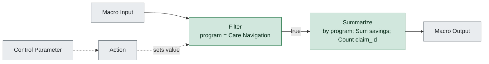

# wf4_program_summary.yxmc

**Redshift migration difficulty: 1/10**, direct translation. 2 tools, 0 migration gotchas.

## In short

This macro filters claims data to the 'Care Navigation' program and then summarizes savings and claim counts by program. It scores 1 out of 10, the lowest difficulty band, because both tools used are simple, direct-translation operations. There are no gotchas or structural complications noted in the facts.

*Written by AI (claude-sonnet-5) from facts extracted by code; every cited tool was checked.*

## How data flows

## Main risks

**Unlabeled upstream/downstream tools** (low)  
The data flow shows tools 2, 4, 5, and 7 feeding into or out of the filter and summarize steps, but the facts don't describe what these tools do. This can't be assessed from the workflow file as given.

## Next steps

1. Confirm what tools 2, 4, 5, and 7 do, since they are not detailed in the extracted facts but are part of the data flow.
2. Translate Filter [3] into a WHERE clause for program = 'Care Navigation'.
3. Translate Summarize [6] into a GROUP BY program with SUM(savings) and COUNT(claim_id).
4. Validate the Redshift output against the original macro's output for a sample of records.

## Every gotcha found

| Severity | Issue | Tools | What to do in Redshift |
|---|---|---|---|
