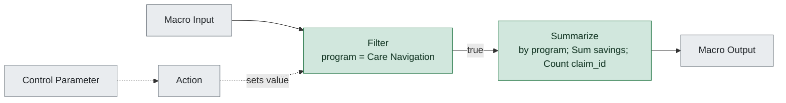

# wf4_program_summary.yxmc

**Redshift migration difficulty: 1/10**, direct translation. 2 tools, 0 migration gotchas.

## In short

This workflow filters records to a single program (Care Navigation) and then summarizes the result by summing savings and counting claims. It scores 1 out of 10, meaning it is a direct translation to SQL. Both tools used have simple, well-known SQL equivalents, so there are no design decisions or rework needed.

*Written by AI (claude-sonnet-5) from facts extracted by code; every cited tool was checked.*

## How data flows

## Main risks

## Next steps

1. Translate the Filter [3] into a WHERE clause for program = 'Care Navigation'.
2. Translate the Summarize [6] into a GROUP BY query with SUM(savings) and COUNT(claim_id).
3. Confirm the exact field names and data types for program, savings, and claim_id before writing the SQL.
4. Validate the Redshift output against the original workflow output for the Care Navigation program to confirm matching totals.

## Every gotcha found

| Severity | Issue | Tools | What to do in Redshift |
|---|---|---|---|
