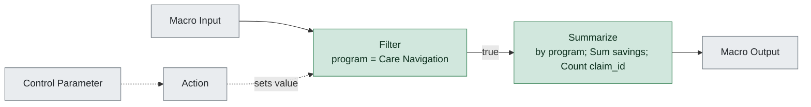

# wf4_program_summary.yxmc

**Redshift migration difficulty: 1/10**, direct translation. 2 tools, 0 migration gotchas.

## In short

This macro filters claims data to the 'Care Navigation' program and then summarizes the results by program, summing savings and counting claim IDs. It scored 1 out of 10, meaning it translates to Redshift SQL almost directly with no significant rework needed. The only two scored tools, Filter [3] and Summarize [6], both map cleanly to standard SQL (WHERE clause and GROUP BY with aggregates).

*Written by AI (claude-sonnet-5) from facts extracted by code; every cited tool was checked.*

## How data flows

## Main risks

**No significant risks identified** (low)  
The facts show no gotchas and only low-difficulty tools, so there is nothing flagged that would complicate migration.

## Next steps

1. Translate the Filter [3] condition into a SQL WHERE clause.
2. Translate the Summarize [6] step into a GROUP BY query with SUM(savings) and COUNT(claim_id).
3. Confirm what tools 2, 4, 5, and 7 do, since the facts only describe their position in the data flow, not their function.
4. Validate the Redshift query output against the original macro's results using a sample dataset.

## Every gotcha found

| Severity | Issue | Tools | What to do in Redshift |
|---|---|---|---|
