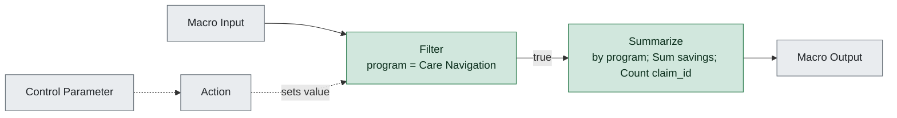

# wf4_program_summary.yxmc

**Redshift migration difficulty: 1/10**, direct translation. 2 tools, 0 migration gotchas.

## In short

This workflow (a macro, which is a reusable Alteryx sub-process) filters records to the 'Care Navigation' program, then summarizes the data by summing savings and counting claim IDs. It scores 1 out of 10, meaning it translates directly to SQL with minimal rework. Both tools used - the Filter [3] and Summarize [6] - are simple, well-understood operations with clean SQL equivalents.

*Written by AI (claude-sonnet-5) from facts extracted by code; every cited tool was checked.*

## How data flows

## Main risks

## Next steps

1. Confirm the business logic for tools [2], [4], and [5] since their function isn't detailed in these facts.
2. Translate the Filter [3] to a SQL WHERE clause filtering on program = 'Care Navigation'.
3. Translate the Summarize [6] to a SQL GROUP BY on program, with SUM(savings) and COUNT(claim_id).
4. Verify what tool [7] does with the summarized output, as it is outside the scope of these facts.

## Every gotcha found

| Severity | Issue | Tools | What to do in Redshift |
|---|---|---|---|
