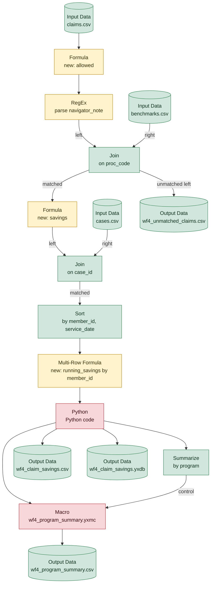

# wf4_savings_report.yxmd

**Redshift migration difficulty: 9/10**, major rework. 17 tools, 16 migration gotchas.

> Calls the macro [wf4_program_summary.yxmc](wf4_program_summary.md), assessed in its own report.

## In short

This workflow calculates claim savings by joining claims, benchmarks, and case data, computing a running savings total per member, flagging top savers, and summarizing by program into four output files. It scores 9/10, the highest difficulty band, mainly because it uses a Python tool [13] with no SQL equivalent and calls an external macro [16] whose logic must be assessed separately. Several other pieces (RegEx [3], Multi-Row Formula [12]) also require rewriting as different SQL constructs.

*Written by AI (claude-sonnet-5) from facts extracted by code; every cited tool was checked.*

## How data flows

## Main risks

**Python tool has no Redshift equivalent** (high)  
The Python step [13] computes a 'top_saver' flag using a statistical quantile calculation; Redshift has no built-in Python execution (and Python UDFs are being discontinued), so this logic must be rewritten in SQL (e.g. using PERCENTILE_CONT) or run outside Redshift.

**Macro logic is in a separate file** (high)  
The Macro [16] (wf4_program_summary.yxmc) contains logic not visible in this workflow file; it must be opened and assessed on its own before the program summary step can be migrated.

**Unmatched join records used downstream** (medium)  
The Join [6] passes its unmatched (left) output to a separate output file; this needs a dedicated LEFT JOIN ... WHERE right_key IS NULL query rather than a single join.

**RegEx translation differences** (medium)  
The RegEx tool [3] is case-insensitive, extracts a capture group, and uses Perl-style patterns; Redshift's REGEXP_SUBSTR is case-sensitive and POSIX-based by default, so the 'i', 'e', and 'p' parameters must be added and the result verified.

**Running total needs window function with explicit frame** (medium)  
The Multi-Row Formula [12] builds a running total by referencing the prior row; in Redshift this becomes a SUM() OVER (...) window function, which requires an explicit frame clause to behave the same way.

**Text-to-number conversion may fail on bad data** (medium)  
Currency text (e.g. '$', commas) is stripped before converting to numbers [2], and another conversion happens in [8]; in Redshift, any value that isn't a valid number after cleaning will cause the whole query to fail, unlike Alteryx's more tolerant handling.

## Next steps

1. Open and analyze the macro file wf4_program_summary.yxmc separately, since its logic is not in this workflow.
2. Decide how to replace the Python top_saver calculation [13] in SQL (e.g. PERCENTILE_CONT) or plan to run it outside Redshift.
3. Test the RegEx pattern [3] in Redshift with the 'i', 'e', and 'p' parameters to confirm it matches Alteryx's output.
4. Rewrite the running savings calculation [12] as a window function with an explicit frame clause and validate results row by row.
5. Audit the allowed_amount and benchmark_cost fields for all currency formats to ensure cleaning logic [2, 8] covers every case before casting.
6. Build the unmatched-claims query [6] as a separate LEFT JOIN ... WHERE IS NULL statement and confirm row counts match the original output.

## Every gotcha found

| Severity | Issue | Tools | What to do in Redshift |
|---|---|---|---|
| high | Calls a macro, whose logic lives in a separate file. | 16 | Analyze the macro file on its own; it must be migrated too. |
| high | Runs Python code, which has no SQL equivalent. | 13 | Rewrite the logic in SQL if possible, or run it outside Redshift. Python UDFs are no longer supported (after June 30, 2026). |
| medium | Unmatched Join records (L or R output) are used downstream. | 6 | LEFT JOIN ... WHERE right_key IS NULL, as a separate query. |
| medium | The RegEx tool is set to ignore case. | 3 | Redshift regex is case-sensitive by default; add the 'i' parameter. |
| medium | The RegEx tool extracts part of the match (a capture group). | 3 | REGEXP_SUBSTR returns the whole match unless the 'e' parameter is added. |
| medium | Uses a regular expression, and Redshift's default regex dialect differs from Alteryx's. | 3 | REGEXP_SUBSTR. Redshift uses POSIX by default; add the 'p' parameter for Perl-style patterns (\d, \W, ...). |
| medium | Refers to values in other rows (e.g. a running total). | 12 | Window functions (LAG, LEAD, or SUM(...) OVER (PARTITION BY ... ORDER BY ... ROWS UNBOUNDED PRECEDING)). Redshift requires the frame clause when the window has ORDER BY. |
| medium | Numbers arrive as formatted text (e.g. currency symbols, commas) and are cleaned before conversion. | 2 | Clean with REPLACE before CAST, or load the column with the right type. Every format in the data must be covered. |
| medium | Converts text to numbers. A value that isn't a valid number can behave differently. | 2, 8 | CAST(x AS DECIMAL(...)). In Redshift, invalid text makes the whole query fail. |
| low | Reads a CSV file, which carries no data types. | 1, 5, 9 | Load with COPY into a table whose column types are defined explicitly. |
| low | IIF has no Redshift equivalent. | 8, 12 | Rewrite as CASE WHEN ... THEN ... ELSE ... END. |
| low | Null check. | 12 | x IS NULL. |
