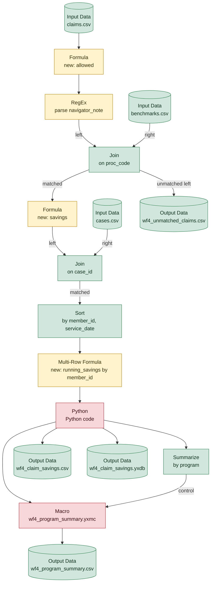

# wf4_savings_report.yxmd

**Redshift migration difficulty: 9/10**, major rework. 17 tools, 16 migration gotchas.

> Calls the macro [wf4_program_summary.yxmc](wf4_program_summary.md), assessed in its own report.

## In short

This workflow builds a savings report by joining claims, benchmark, and case data, calculating a running savings total per member, parsing a note field, running a custom Python calculation, and producing a program-level summary through a separate macro. It scores 9/10, the highest difficulty band, mainly because of the Python tool [13] (no SQL equivalent) and the Macro [16] (logic lives in a separate file that must be migrated independently). RegEx [3] and Multi-Row Formula [12] add further rework because their logic needs different techniques in Redshift. Four separate output files also mean four separate SQL outputs to build and validate.

*Written by AI (claude-sonnet-5) from facts extracted by code; every cited tool was checked.*

## How data flows

## Main risks

**Python logic has no SQL equivalent** (high)  
The Python tool [13] computes a 'top saver' flag using a statistical percentile (quantile). Redshift has no Python UDF support after June 2026, so this logic must be rewritten in SQL (e.g. using PERCENTILE_CONT) or run outside Redshift.

**Macro logic not visible in this file** (high)  
The Macro [16] calls a separate file (wf4_program_summary.yxmc) whose internal logic is not included in these facts. It must be assessed and migrated on its own before the full workflow's difficulty is known.

**Running total needs a window function with explicit frame** (medium)  
The Multi-Row Formula [12] builds a running total row-by-row, which translates to a SQL window function (SUM OVER). Redshift requires an explicit frame clause (e.g. ROWS UNBOUNDED PRECEDING) when ORDER BY is used, or results will differ.

**Unmatched join records used downstream** (medium)  
The Join [6] passes its unmatched (non-joining) records to a separate output. This must be rebuilt as a distinct LEFT JOIN ... WHERE ... IS NULL query, since Redshift doesn't have a built-in 'unmatched' output like Alteryx.

**RegEx behavior differs between Alteryx and Redshift** (medium)  
The RegEx tool [3] is case-insensitive and extracts a capture group, but Redshift's REGEXP_SUBSTR is case-sensitive by default and returns the whole match unless extra parameters ('i', 'e') are added. Redshift also defaults to POSIX regex syntax, not Perl-style, so the pattern may need rewriting.

**Currency text-to-number conversion is fragile** (medium)  
Formulas [2] and [8] strip currency symbols and commas before converting text to numbers. In Redshift, any value that doesn't match the expected format will fail the entire query rather than just that row, so all formats in the real data must be accounted for.

## Next steps

1. Obtain and analyze the macro file wf4_program_summary.yxmc separately before finalizing the migration plan.
2. Decide how to replace the Python top-saver logic [13], e.g. rewrite with a SQL percentile function or run it in an external process.
3. Rebuild the running savings calculation [12] as a SQL window function with an explicit frame clause.
4. Test the regex pattern from [3] in Redshift with the 'i' and 'e' parameters, and confirm POSIX vs Perl syntax compatibility.
5. Recreate the unmatched-join output [6] as a separate LEFT JOIN query with an IS NULL filter.
6. Audit the real claims data for all currency formatting variants to ensure the CAST/REPLACE logic in [2] and [8] won't fail on real values.

## Every gotcha found

| Severity | Issue | Tools | What to do in Redshift |
|---|---|---|---|
| high | Calls a macro, whose logic lives in a separate file. | 16 | Analyze the macro file on its own; it must be migrated too. |
| high | Runs Python code, which has no SQL equivalent. | 13 | Rewrite the logic in SQL if possible, or run it outside Redshift. Python UDFs are no longer supported (after June 30, 2026). |
| medium | Unmatched Join records (L or R output) are used downstream. | 6 | LEFT JOIN ... WHERE right_key IS NULL, as a separate query. |
| medium | The RegEx tool is set to ignore case. | 3 | Redshift regex is case-sensitive by default; add the 'i' parameter. |
| medium | The RegEx tool extracts part of the match (a capture group). | 3 | REGEXP_SUBSTR returns the whole match unless the 'e' parameter is added. |
| medium | Uses a regular expression, and Redshift's default regex dialect differs from Alteryx's. | 3 | REGEXP_SUBSTR. Redshift uses POSIX by default; add the 'p' parameter for Perl-style patterns (\d, \W, ...). |
| medium | Refers to values in other rows (e.g. a running total). | 12 | Window functions (LAG, LEAD, or SUM(...) OVER (PARTITION BY ... ORDER BY ... ROWS UNBOUNDED PRECEDING)). Redshift requires the frame clause when the window has ORDER BY. |
| medium | Numbers arrive as formatted text (e.g. currency symbols, commas) and are cleaned before conversion. | 2 | Clean with REPLACE before CAST, or load the column with the right type. Every format in the data must be covered. |
| medium | Converts text to numbers. A value that isn't a valid number can behave differently. | 2, 8 | CAST(x AS DECIMAL(...)). In Redshift, invalid text makes the whole query fail. |
| low | Reads a CSV file, which carries no data types. | 1, 5, 9 | Load with COPY into a table whose column types are defined explicitly. |
| low | IIF has no Redshift equivalent. | 8, 12 | Rewrite as CASE WHEN ... THEN ... ELSE ... END. |
| low | Null check. | 12 | x IS NULL. |
